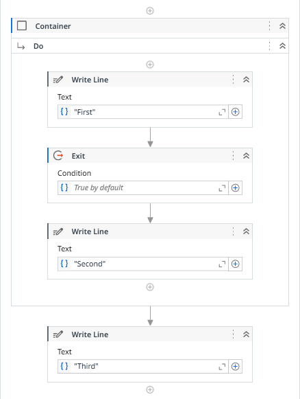
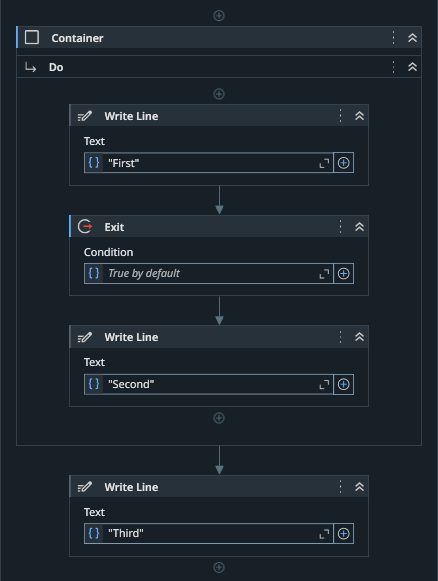
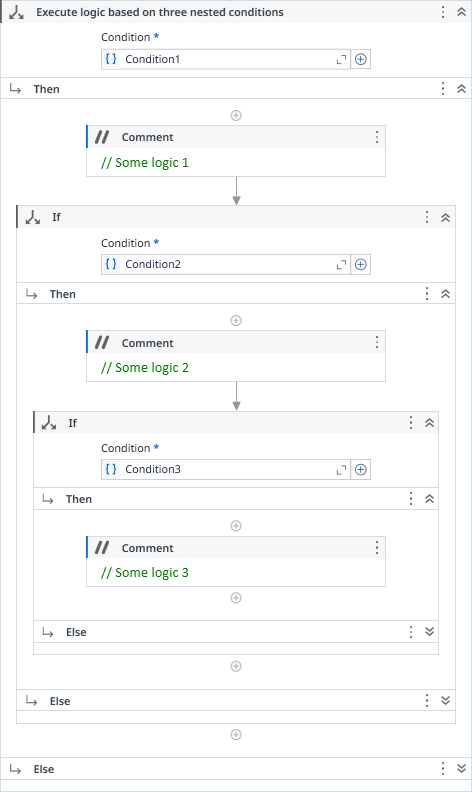
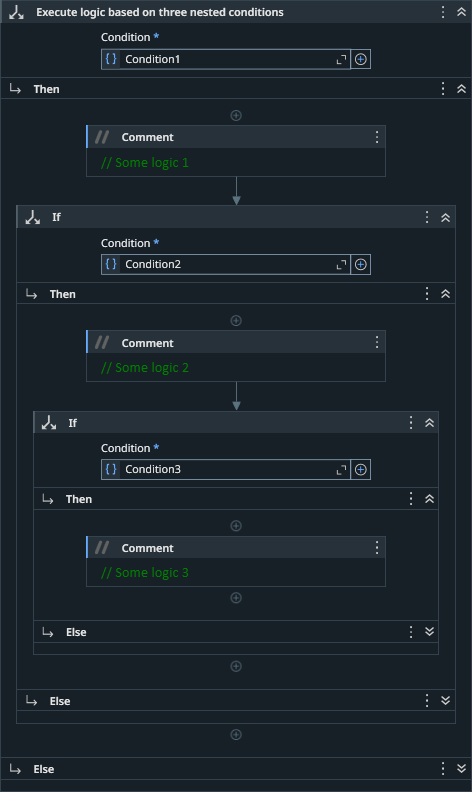
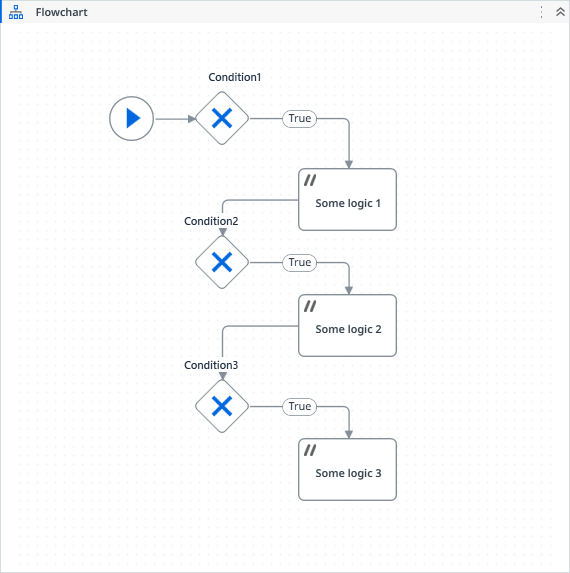
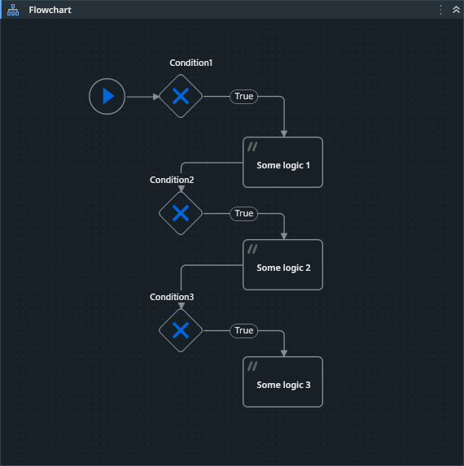
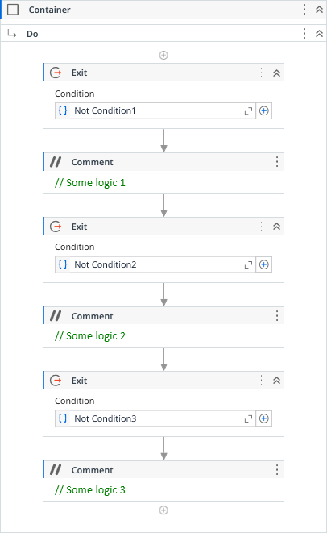
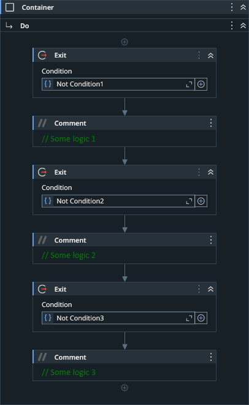

### Usage

The **Container** activity has no effect if not combined with **Exit** activity.

With these two activities, we can avoid nested conditional Ifs or exit early from a workflow wrapped in a **Container**.

Consider the below code:




Only the messages *"First"* and *"Third"* will be printed out.

Based on its condition, the **Exit** activity tells to **Container** interrupt its execution. Then, the process flow continues to the next activity.

Below is an abstraction of what happens to the execution flow:

```
+------------------------------------+
|             Container              |
|         +----------------+         |
|         |   Write Line   |         |
|         |    "First"     |         |
|         +-------+--------+         |
|                 v                  |
|         +----------------+         |
|  +----- |      Exit      |         |
|  |      +-------+--------+         |
|  |              v                  |
|  |      +----------------+         |
|  |      |   Write Line   |         |
|  |      |    "Second"    |         |
|  |      +----------------+         |
+--|---------------------------------+
   |              v
   |      +----------------+
   +----> |   Write Line   |
          |    "Third"     |
          +----------------+
```

Everything that is below the **Exit** activity and inside the **Container** will be ignored/skipped and the execution flow will continue to the next activity after the **Container**.

This is very useful to avoid nested Ifs or to exit early from a workflow when certain conditions are not met.

See below the different approaches for handling multiple nested conditions.

:::tabs
== Ifs in a Sequence


== Decisions in a Flow Chart


== Container & Exit


:::

::: info SEE ALSO
- [Exit](exit.md)
:::